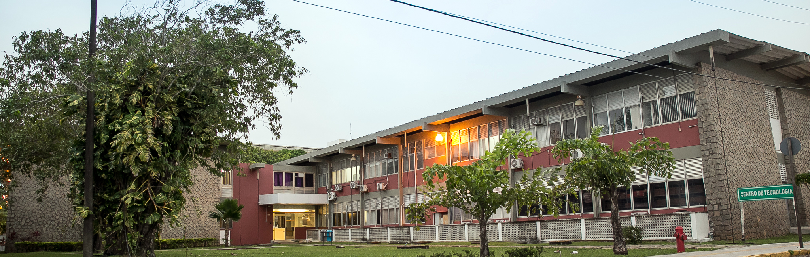

# Federal University of Rio Grande do Norte
## Technology Center
### Department of Computer Engineering and Automation 
#### Algorithms and Data Structure II (DCA3702)

This is the repository for the Algorithms and Data Structures II course, offered by the Department of Computer Engineering and Automation ([DCA](https://www.dca.ufrn.br)) of the Technology Center ([CT](https://www.ct.ufrn.br/)) at the Federal University of Rio Grande do Norte ([UFRN](https://www.ufrn.br)).

The DCA aims to train professionals capable of designing and developing computer systems for industrial automation, embedded systems, software systems, distributed systems, computer networks, and information systems. The CT offers undergraduate and graduate courses in Engineering. This course is part of the curriculum of the Computer Engineering program at DCA/UFRN.

#### References

- :books: [Coscia, Michele. The Atlas for the Aspiring Network Scientist](https://www.networkatlas.eu/)
- :books: [Newman, Mark. Networks](https://global.oup.com/academic/product/networks-9780198805090?cc=br&lang=en&)

| Tool | Link |
|------|------|
| :smiley: Networkx | [networkx.org](https://networkx.org/) |
| :gear: Gephi | [gephi.org](https://gephi.org/) |
| :rocket: OSMnx | [github.com/gboeing/osmnx](https://github.com/gboeing/osmnx) |
| :floppy_disk: Dataset | [snap.stanford.edu/data](https://snap.stanford.edu/data/) |

### Lessons

**Week 01**
-  **Course Outline:** Provides an overview of the course structure and topics covered.
    -  🎉 GitHub Education Benefits
        - GitHub Education Pro: Get access to the GitHub Education Pro pack by visiting [GitHub Education](https://education.github.com/pack)
    - 📖 Learning Resources 
        - GitHub Learning Game: Check out the interactive Git learning game at [GitHub Learning Game](https://learngitbranching.js.org/)

**Week 02**
-  **From Real-World Systems to Networks**: Learn how real-world systems can be modeled as networks. We introduce the basic elements of a graph, explore different types of networks, and discuss applications involving social networks, transportation, temporal networks, and knowledge graphs.
    -  **Hands-on — Modeling Networks with NetworkX**: Build, inspect, and manipulate graphs in Python. Practice graph representations, node and edge attributes, directed graphs, multigraphs, degree and neighborhood analysis, connectivity, and modeling decisions through guided examples and exercises.
    - :books: **Further Reading & Practice**:
        - Chapters 2, 3, 6, and 7 of [The Atlas for the Aspiring Network Scientist](https://www.networkatlas.eu/).
        - [NetworkX Documentation](https://networkx.org/)
-  **Network Fundamentals II**: Extended graphs, density and sparsity, subnetworks, degree, degree distribution, and network representation.
    -  Exploring graph types, multilayer networks, density, subnetworks, degree, and adjacency matrices using NetworkX.
    - :books: Further reading: chapters 7, 8, and 9 of the book [The Atlas For The Aspiring Network Scientist](https://www.networkatlas.eu/).

**Week 03**
-  **Small-World Networks and Graph Traversal**: Introduction to the small-world phenomenon through classical examples such as Milgram's experiment, the Erdős number, and the Oracle of Bacon. The lecture connects these concepts to graph traversal and shortest-path reasoning, with particular emphasis on Breadth-First Search (BFS) and Depth-First Search (DFS).
    - **Case Study — Wikipedia Network:** Construction and structural analysis of a directed network of Wikipedia pages using a snowball sampling strategy.
        - Compare BFS and DFS in terms of exploration strategy, frontier size, memory requirements, and path discovery.
        - Construct a directed network from Wikipedia pages starting from a predefined seed node.
        - Collect pages through a BFS-based snowball sampling process and analyze the growth of successive network layers.
        - Preprocess the network by handling duplicate nodes, self-loops, and sampling artifacts.
        - Examine the degree distribution and distinguish the network core from its low-degree fringe.
        - Analyze node relevance through indegree and outdegree and discuss the impact of the sampling strategy on the observed network structure.
        -  **Wikipedia Network — BFS-Based Sampling and Structural Analysis**

**Week 04**
-  **Network Navigation and Local Structure**: This lesson moves beyond graph representation to explore how nodes can be reached, how distances are measured, how connected regions emerge, and how local relationships form triangles and clusters.
    -  **Hands-on — Paths, Components, and Clustering**
        - Walks, trails, paths, and powers of the adjacency matrix
        - Shortest paths in directed, undirected, weighted, and unweighted networks
        - Average shortest-path length, diameter, and global efficiency
        - Connected components and the Giant Connected Component (GCC)
        - Weakly and Strongly Connected Components (WCC and SCC)
        - Triangles, clustering coefficient, and the friend-of-a-friend principle
        - Practical applications using NetworkX and real-world network examples
    -  **Advanced Network Visualization with nxviz**
        - The nxviz grammar: node tables, edge tables, grouping, sorting, and visual encodings
        - Arc, Circos, Matrix, Hive, and geographic plots
        - Mapping node and edge attributes to color, size, transparency, and line width
        - Revealing communities, hubs, bridges, and structural patterns
        - Combining nxviz layouts with Matplotlib and Plotly
        - Designing deterministic and publication-ready network visualizations
